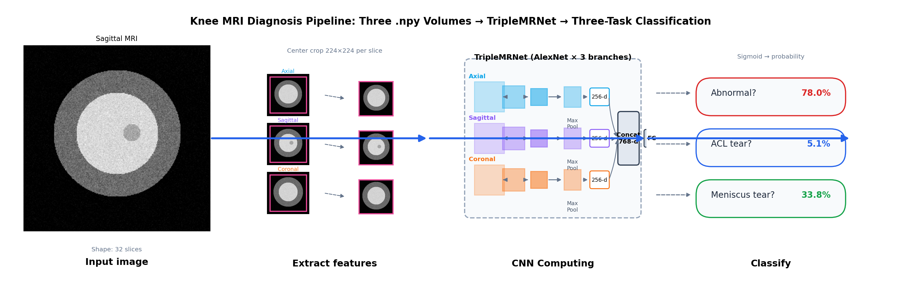

# KneeMRI-GPT

Knee MRI diagnosis support that pairs a three-plane CNN with an LLM report generator. The vision module predicts three findings (abnormality, ACL tear, meniscal tear) from axial, sagittal and coronal MRI series. The reporting module turns those probabilities into a structured, readable report.

BSc dissertation project, Oxford Brookes University & Chengdu University of Technology, 2026.



> Research and teaching use only. Not a medical device and not for clinical diagnosis.

## What I built

The vision model is trained with **TripleMRNet** (three ImageNet-pretrained AlexNet branches, one per MRI plane) from the open-source [MRNet-Competition](https://github.com/yashbhalgat/MRNet-Competition) code by Yash Bhalgat. That code is not included here (see [Setup](#setup)). My own work is:

| Part | File | What it does |
| --- | --- | --- |
| Training and evaluation | `notebooks/training_and_evaluation.ipynb` | Trains the three task models, picks checkpoints by validation AUC and loss, and runs error analysis plus ablations of abnormal-prior gating and decision thresholds |
| Inference service | `src/web_infer.py` | Loads the three task models and uses the abnormality probability as a prior for the ACL and meniscus predictions |
| LLM report generator | `src/web_report.py` | Calls Qwen3-Max through the DashScope OpenAI-compatible API with prompt constraints, validates the required JSON fields, and falls back to a rule-based report if the call or validation fails |
| Diagram script | `scripts/generate_cnn_pipeline_diagram.py` | Draws the pipeline figure above (uses synthetic volumes when no real data is given) |

A Flask web demo (three-view upload, inference, report rendering) was used for functional testing in the dissertation. Its front end is not included in this repository.

## Results

Validation-set results as reported in the dissertation. The trained weights are not released, so these numbers cannot be reproduced from this repository alone.

| Task | AUC | Recall | F1 | Accuracy |
| --- | --- | --- | --- | --- |
| Abnormal | 0.9520 | 0.9789 | 0.9163 | 0.8583 |
| ACL tear | 0.9697 | 0.8889 | 0.8727 | 0.8833 |
| Meniscal tear | 0.8125 | 0.7115 | 0.7048 | 0.7417 |

Abnormal-prior gating (multiplying the ACL or meniscus probability by the abnormality probability) raised AUC but traded fewer false positives for more false negatives:

| Task | AUC without prior | AUC with prior | FP without → with | FN without → with |
| --- | --- | --- | --- | --- |
| ACL tear | 0.9649 | 0.9697 | 8 → 7 | 5 → 7 |
| Meniscal tear | 0.8125 | 0.8298 | 16 → 14 | 15 → 16 |

## Repository structure

```
KneeMRI-GPT/
├── src/
│   ├── web_infer.py         # inference service with abnormal prior
│   └── web_report.py        # LLM structured report generator
├── notebooks/
│   └── training_and_evaluation.ipynb
├── scripts/
│   └── generate_cnn_pipeline_diagram.py
├── docs/
│   ├── knee_mri_pipeline_diagram.png
│   └── system_architecture.drawio
├── requirements.txt
├── .env.example
└── .gitignore
```

## Setup

1. **Get the data.** Request the MRNet dataset from the [Stanford ML Group](https://stanfordmlgroup.github.io/competitions/mrnet/). Its research use agreement does not allow redistribution, so no data is included. Put it under `data/` (`data/train`, `data/valid` and the label CSVs).
2. **Add the base model code.** Clone [MRNet-Competition](https://github.com/yashbhalgat/MRNet-Competition) and copy `model.py`, `loader.py`, `evaluate.py`, `utils.py`, `train.py` and `submit_predictions.py` from its `src/` into this repository's `src/`. In `train.py`, change `os.walk(args.rundir)` to `os.walk(rundir)` so it works when called from the notebook. These files are listed in `.gitignore` so they are not committed by accident.
3. **Install dependencies.**
   ```bash
   pip install -r requirements.txt
   ```
4. **Set the API key** for report generation (copy `.env.example` and fill it in, or set it in your shell):
   ```bash
   export DASHSCOPE_API_KEY=your-key-here          # macOS / Linux
   $env:DASHSCOPE_API_KEY="your-key-here"          # Windows PowerShell
   ```
   Without a key, report generation returns the rule-based fallback report instead of failing.
5. **Train and evaluate** by running the notebook from the `notebooks/` folder. Checkpoints are written to `runs/`.

Generate a report from three probabilities:

```python
from web_report import explain_diagnosis_with_qwen

report = explain_diagnosis_with_qwen("study_001", abnormal_prob=0.9965, acl_prob=0.8435, meniscus_prob=0.5753)
print(report["summary"], report["risk_level"])
```

## Limitations

- Trained and evaluated on one public dataset (MRNet); not validated on external data.
- Meniscal tear detection is noticeably weaker than the other two tasks.
- The LLM report only restates model probabilities. It does not see the images.

## Acknowledgements

- MRNet dataset and baseline: Bien et al., 2018, Stanford ML Group.
- [MRNet-Competition](https://github.com/yashbhalgat/MRNet-Competition) by Yash Bhalgat, which evolved from [MRNet-Baseline](https://github.com/aneergaard/MRNet).

## Licence

No licence has been chosen yet. The upstream MRNet-Competition repository has no licence file, so its code is not redistributed here.
